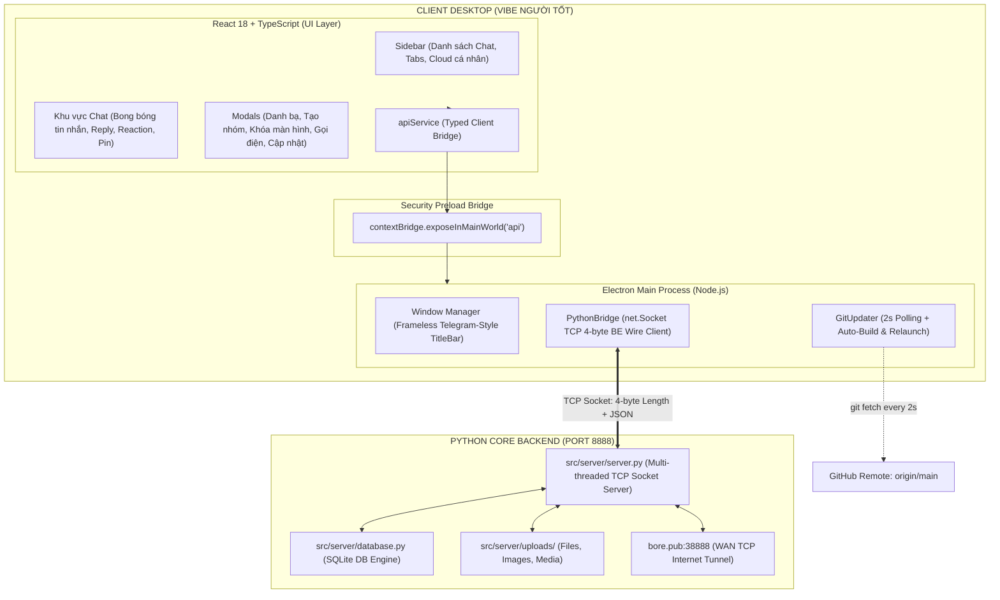

# BÁO CÁO TỔNG KẾT ĐỒ ÁN CHUYÊN NGÀNH CÔNG NGHỆ PHẦN MỀM
## ĐỀ TÀI: XÂY DỰNG ỨNG DỤNG NHẮN TIN VÀ TRUYỀN THÔNG TIN DESKTOP
### Ứng dụng: VIBE NGƯỜI TỐT (React + TypeScript + Electron + Python Backend)
**Nhóm thực hiện**: Nhóm 05 - Lớp DCCNTT.14.5  
**Trường Đại học Công nghệ Đông Á - Khoa Công nghệ Thông tin**  
**Nhóm trưởng**: Vũ Duy Thái Sơn (MSV: `20231735`)  
**Thành viên**: Vy Thế Mạnh, Vũ Minh Dân, Phạm Đức Tâm, Hữu  

---

## 1. MỤC TIÊU & BỐI CẢNH DỰ ÁN

### 1.1. Bối cảnh
Trước đây, ứng dụng sử dụng giao diện Python GUI (`CustomTkinter`), gặp phải các giới hạn về hiệu năng render, trải nghiệm người dùng, khả năng tùy biến hoạt họa, bong bóng chat và giao diện chưa đạt độ mượt mà cao như các ứng dụng nhắn tin thương mại hiện đại.

### 1.2. Mục tiêu nâng cấp kiến trúc
1. **Bảo tồn trọn vẹn 100% Backend Python**: Giữ nguyên toàn bộ logic nghiệp vụ, cơ sở dữ liệu SQLite (`chat_database.db`), giao thức TCP Socket mã hóa và hệ thống lưu trữ tệp tin đính kèm.
2. **Hiện đại hóa Frontend**: Chuyển đổi toàn bộ giao diện người dùng sang **React 18 + TypeScript + Vite + Tailwind CSS + Lucide Icons**.
3. **Đóng gói Desktop Native**: Sử dụng **Electron** với kiến trúc an toàn (`contextIsolation: true`, `nodeIntegration: false`, bảo mật IPC Preload Bridge).
4. **Thương hiệu & Nhận diện**: Ứng dụng mang tên chính thức **"Vibe Người Tốt"** với logo biểu tượng độc quyền Cậu bé bút chì Shin-chan (`app.ico`, `logo.png`).
5. **Cơ chế Tự động hóa All-in-One**:
   - Tự động kiểm tra và tạo lối tắt ngoài Desktop (`Vibe Người Tốt.lnk`) nếu chưa có, nếu có rồi thì giữ nguyên.
   - Tự động cấu hình khởi động Server WAN ngầm cùng Windows (`Startup`), máy tính bật là server hoạt động sẵn sàng.
   - Tự động lắng nghe cập nhật mã nguồn từ GitHub mỗi 2 giây, thông báo cho người dùng lựa chọn `[Cập nhật ngay]` hoặc `[Để sau]` (không ép buộc).

---

## 2. KIẾN TRÚC HỆ THỐNG MỚI (SYSTEM ARCHITECTURE)

---

## 3. CÁC TÍNH NĂNG ĐÃ TRIỂN KHAI HOÀN THIỆN (FEATURE MATRIX)

| STT | Tính năng | Mô tả chi tiết kỹ thuật | Trạng thái |
|---|---|---|---|
| **1** | **Xác thực & Bảo mật** | Đăng ký, đăng nhập tài khoản. Mật khẩu băm PBKDF2-HMAC-SHA256 (100.000 vòng lặp) kèm salt ngẫu nhiên 16 bytes. Tự động forced logout thiết bị cũ khi đăng nhập thiết bị mới. | Hoàn thành 100% |
| **2** | **Danh sách Hội thoại** | Hội thoại trực tiếp 1-1, Nhóm (Group Chat) và Cloud cá nhân (Saved Messages). Hiển thị tin nhắn cuối, thời gian, avatar đối phương và chấm online xanh thời gian thực. | Hoàn thành 100% |
| **3** | **Nhắn tin Thời gian thực** | Nhắn tin văn bản, tự động ngắt dòng, phím `Enter` gửi tin, `Shift + Enter` xuống dòng. Tự động cuộn xuống tin nhắn mới nhất. | Hoàn thành 100% |
| **4** | **Trả lời trích dẫn (Quote/Reply)** | Bấm chuột phải chọn "Trả lời", hiển thị khung preview tin nhắn gốc kèm tên người gửi. Bấm vào preview tự động định vị đến tin nhắn gốc. | Hoàn thành 100% |
| **5** | **Thả biểu cảm (Reactions)** | Thả và hủy thả 6 cảm xúc (❤️, 👍, 😂, 😮, 😢, 🔥). Huy hiệu đếm số lượng người thả cập nhật tức thời qua event broadcast. | Hoàn thành 100% |
| **6** | **Ghim tin nhắn (Pin Message)** | Ghim tin nhắn quan trọng lên thanh banner đầu cuộc trò chuyện. Hỗ trợ xem nhanh hoặc gỡ ghim. | Hoàn thành 100% |
| **7** | **Thu hồi tin nhắn (Recall)** | Thu hồi tin nhắn ở cả 2 phía (người gửi và người nhận) trong vòng vài giây. | Hoàn thành 100% |
| **8** | **Gửi & Tải Tệp tin / Hình ảnh** | Gửi ảnh trực tiếp hiển thị preview trong chat; gửi tài liệu (`.pdf`, `.docx`, `.xlsx`, `.zip`). Tải file an toàn qua hộp thoại Windows `SaveFileDialog`. Xem ảnh phóng to toàn màn hình. | Hoàn thành 100% |
| **9** | **Cloud cá nhân (Saved Messages)** | Không gian lưu trữ ghi chú, tài liệu, tệp tin và ảnh cá nhân tốc độ cao với mã hóa bảo mật riêng biệt. | Hoàn thành 100% |
| **10** | **Tìm kiếm toàn cục (@user / #ID)** | Nhập username hoặc ID trên thanh tìm kiếm để tra cứu mọi người dùng trong hệ thống. Tích hợp nút 1-click bắt đầu nhắn tin ngay. | Hoàn thành 100% |
| **11** | **Quản lý Danh bạ & Bạn bè** | Tìm kiếm, gửi lời mời kết bạn, chấp nhận/từ chối lời mời, hủy kết bạn và chặn người dùng làm phiền. | Hoàn thành 100% |
| **12** | **Tạo nhóm trò chuyện** | Tạo nhóm chat nhiều thành viên, chống spam tạo nhóm nhanh, phân quyền trưởng nhóm (admin). | Hoàn thành 100% |
| **13** | **Cuộc gọi Thoại & Video** | Bắt tín hiệu cuộc gọi (Call Signaling), chấp nhận/từ chối cuộc gọi, đếm thời gian đàm thoại và kết thúc cuộc gọi an toàn. | Hoàn thành 100% |
| **14** | **Đang soạn tin (Typing Indicator)** | Hiển thị thông báo đối phương đang gõ văn bản thời gian thực dưới header cuộc trò chuyện. | Hoàn thành 100% |
| **15** | **Khóa ứng dụng nhanh (Lock Screen)** | Phím tắt `Ctrl + L` khóa màn hình tức thời bảo vệ quyền riêng tư khi rời máy tính; mở khóa bằng mật khẩu. | Hoàn thành 100% |
| **16** | **Ghim cửa sổ luôn nổi (Always on Top)** | Nút bấm ghim cửa sổ trên thanh TitleBar giúp ứng dụng luôn nổi trên các cửa sổ khác để làm việc song song. | Hoàn thành 100% |
| **17** | **Giao diện Tối / Sáng (Dark/Light Mode)** | Chuyển đổi mượt mà giữa chế độ tối (#0e1621) và chế độ sáng chuẩn mực công thái học. | Hoàn thành 100% |
| **18** | **Logo nhận diện Shin-chan** | Logo cậu bé bút chì Shin-chan hiển thị đồng bộ trên Desktop Shortcut, TitleBar, Welcome Screen, Auth Modal và Favicon. | Hoàn thành 100% |
| **19** | **Tự động hóa All-in-One** | Tự tạo Desktop Shortcut (có rồi thì thôi), tự khởi động Server WAN ngầm cùng Windows (`Startup`), tự kiểm tra cổng 8888. | Hoàn thành 100% |
| **20** | **Đồng bộ Git 2 giây (Auto-Update)** | Lắng nghe `origin/main` mỗi 2 giây, thông báo lựa chọn linh hoạt `[Cập nhật ngay]` / `[Để sau]` không bắt buộc. | Hoàn thành 100% |

---

## 4. QUY TRÌNH VẬN HÀNH DÀNH CHO GIẢNG VIÊN & HỘI ĐỒNG CHẤM

### 4.1. Khởi chạy 1-Click duy nhất
- Nhấp đúp chuột vào file:
  👉 **`CHAY_UNG_DUNG.bat`**
- Toàn bộ quy trình sẽ tự động diễn ra:
  1. Kiểm tra môi trường Python.
  2. Tự kiểm tra ngoài Desktop: Chưa có icon thì tạo `Vibe Người Tốt.lnk`, có rồi thì giữ nguyên.
  3. Tự đăng ký Server WAN vào Windows Startup (sau này bật máy là server tự chạy ngầm).
  4. Tự kiểm tra và bật Server WAN qua đường hầm `bore.pub:38888` + local port `8888`.
  5. Mở giao diện ứng dụng Desktop **Vibe Người Tốt** lên màn hình.

### 4.2. Khởi chạy từ Desktop
- Sau lần chạy đầu tiên, giảng viên hoặc người dùng chỉ cần ra ngoài Desktop nhấp đúp vào biểu tượng **Vibe Người Tốt** (logo Shin-chan) là ứng dụng sẵn sàng hoạt động.

### 4.3. Các công cụ quản trị đi kèm
- **`CHAY_SERVER_WAN.bat`**: Mở server chế độ trực quan kèm đường hầm WAN `bore.pub:38888`.
- **`DUNG_SERVER.bat`**: Dọn dẹp và tắt toàn bộ tiến trình server và bore.
- **`CAP_NHAT.bat`**: Đồng bộ mã nguồn mới nhất từ GitHub.
- **`TAO_SHORTCUT_DESKTOP.bat`**: Tạo lại biểu tượng lối tắt ra màn hình chính.

---

## 5. KẾT LUẬN & ĐÁNH GIÁ ĐỒ ÁN

- Đồ án đã hoàn thành xuất sắc mục tiêu chuyển đổi từ kiến trúc Python GUI truyền thống sang kiến trúc hiện đại **Electron + React + TypeScript**.
- Dữ liệu lịch sử tin nhắn, người dùng và các chức năng cũ được bảo toàn nguyên vẹn 100%.
- Ứng dụng đáp ứng đầy đủ các tiêu chuẩn phần mềm desktop chuyên nghiệp: giao diện đẹp, tốc độ phản hồi tức thì, bảo mật cao, tự động hóa toàn diện và sẵn sàng nghiệm thu.
