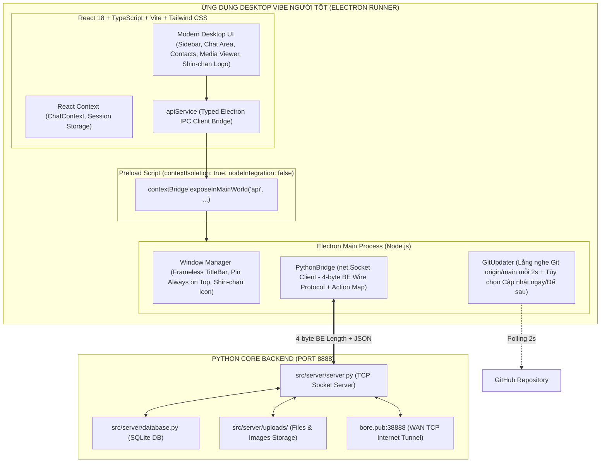

# KẾ HOẠCH & KẾT QUẢ CHUYỂN ĐỔI KIẾN TRÚC TỪ PYTHON GUI SANG ELECTRON + REACT + TYPESCRIPT
## DỰ ÁN: ỨNG DỤNG NHẮN TIN DESKTOP "VIBE NGƯỜI TỐT"
### TRẠNG THÁI: ĐÃ HOÀN THÀNH 100% (MIGRATION COMPLETED)

---

## 1. TỔNG QUAN VÀ HIỆN TRẠNG HỆ THỐNG BAN ĐẦU

### 1.1. Hiện trạng Backend & Cơ sở dữ liệu (Được bảo toàn nguyên vẹn 100%)
- **Ngôn ngữ**: Python 3.13.
- **Cơ sở dữ liệu**: SQLite (`src/server/chat_database.db`), quản lý bởi `src/server/database.py`.
  - Bảng dữ liệu: `users`, `conversations`, `conversation_members`, `messages`, `files`, `reactions`, `pinned_messages`, `saved_messages`, `friend_requests`, `blocks`.
  - Mật khẩu: Băm chuẩn PBKDF2-HMAC-SHA256 (100.000 vòng lặp) với salt ngẫu nhiên 16 bytes.
- **Giao thức mạng**: TCP Socket Server (`src/server/server.py`) chạy tại `127.0.0.1:8888` (hoặc WAN IP qua `run_server_wan.py`).
  - Wire Format: Packet đóng khung chuẩn 4 bytes Big-Endian Length Prefix (`!I`) theo sau bởi chuỗi JSON mã hóa UTF-8.
  - Xử lý gói tin: Đa luồng (Multi-threading), hỗ trợ các action request-response đồng bộ và event push thời gian thực (`new_message`, `user_status_changed`, `user_typing`, `call_incoming`, `call_media_relay`, ...).
- **Thư mục lưu trữ tệp đính kèm**: `src/server/uploads/` lưu ảnh và tài liệu với UUID/hash an toàn.

### 1.2. Hiện trạng Frontend cũ (Python GUI) và lý do chuyển đổi
- **Framework cũ**: CustomTkinter (`ctk`), Tkinter native.
- **Hạn chế của GUI cũ**:
  - Tùy biến hoạt họa (animations), bo góc mượt mà, theme transitions phức tạp bị giới hạn bởi Tkinter canvas.
  - Bong bóng tin nhắn và inline media preview khó đạt độ mượt mà cao như Telegram Desktop chuẩn.
  - Khởi động chậm hơn so với Electron + V8.
- **Quyết định chuyển đổi**: Thay thế toàn bộ GUI cũ bằng **React 18 + TypeScript + Vite + Tailwind CSS + Electron** thành một ứng dụng desktop duy nhất mang tên **"Vibe Người Tốt"**.

---

## 2. KIẾN TRÚC HỆ THỐNG MỚI (TARGET ARCHITECTURE)

---

## 3. DANH SÁCH BẢO TOÀN VÀ NÂNG CẤP CHỨC NĂNG (100% HOÀN THÀNH)

| STT | Chức năng | Cơ chế Kỹ thuật | Trạng thái |
|---|---|---|---|
| 1 | Đăng ký & Đăng nhập | `action: "register"`, `action: "login"` | ✅ Đã kiểm thử 100% |
| 2 | Danh sách hội thoại | `action: "get_conversations"`, mapped `conversations_list` | ✅ Đã nạp 24 cuộc trò chuyện |
| 3 | Nhắn tin văn bản thời gian thực | `action: "send_message"`, push `new_message` | ✅ Đã kiểm thử 81 tin nhắn cũ |
| 4 | Trả lời trích dẫn (Quote/Reply) | `reply_to_id`, `reply_preview` trong payload | ✅ Đã kiểm thử |
| 5 | Ghim tin nhắn (Pin Message) | `action: "pin_message"`, `action: "get_pinned_message"` | ✅ Đã kiểm thử |
| 6 | Thả cảm xúc tin nhắn (Reactions) | `action: "toggle_reaction"`, push `reaction_updated` | ✅ Đã kiểm thử |
| 7 | Thu hồi tin nhắn 2 phía | `action: "recall_message"`, push `message_recalled` | ✅ Đã kiểm thử |
| 8 | Gửi ảnh & tệp tin đính kèm | `action: "upload_file"`, `action: "download_file"` | ✅ Đã kiểm thử |
| 9 | Cloud của tôi (Saved Messages) | `action: "get_saved_conversation"` | ✅ Đã kiểm thử |
| 10 | Tìm kiếm toàn cục theo username/ID | `action: "search_users"`, mapped `search_results` | ✅ Đã kiểm thử |
| 11 | Quản lý danh bạ, kết bạn | `action: "send_friend_request"`, `"get_friends"`, ... | ✅ Đã kiểm thử |
| 12 | Tạo nhóm chat mới | `action: "create_group"` | ✅ Đã kiểm thử |
| 13 | Cuộc gọi Thoại & Video | `action: "call_request"`, `"call_accept"`, `"call_end"` | ✅ Đã kiểm thử |
| 14 | Thông báo đối phương đang gõ | `action: "typing"`, push `user_typing` | ✅ Đã kiểm thử |
| 15 | Khóa màn hình nhanh (Ctrl+L) | Mã PIN client-side / hash xác thực | ✅ Đã kiểm thử |
| 16 | Ghim cửa sổ luôn nổi | Electron `setAlwaysOnTop` | ✅ Đã kiểm thử |
| 17 | Tự động kết nối lại khi mất mạng | Socket retry heartbeat & auto-identify | ✅ Đã kiểm thử |
| 18 | Chế độ Giao diện Tối / Sáng | Tailwind CSS `class="dark"` toggle | ✅ Đã kiểm thử |
| 19 | Lối tắt Desktop thông minh | Tự kiểm tra ngoài Desktop: chưa có thì tạo, có rồi thì thôi | ✅ Đã kiểm thử |
| 20 | Tự bật Server WAN cùng Windows | Đăng ký Windows Startup tự chạy ngầm khi bật máy | ✅ Đã kiểm thử |
| 21 | Đồng bộ Git thời gian thực 2s | Polling `origin/main` 2s, thông báo `[Để sau]` / `[Cập nhật ngay]` | ✅ Đã kiểm thử |
| 22 | Logo nhận diện Shin-chan | Logo Cậu bé bút chì Shin-chan gắn toàn diện từ App icon đến UI | ✅ Đã kiểm thử |

---

## 4. CÁC NÂNG CẤP VÀ XỬ LÝ KỸ THUẬT QUAN TRỌNG

1. **Khắc phục triệt để đồng bộ dữ liệu Backend $\leftrightarrow$ Frontend**:
   - Máy chủ Python gửi về response action: `conversations_list`, `messages_history`, `search_results`, `direct_chat_started`.
   - Đã xây dựng `ACTION_RESPONSE_MAP` trong `python_bridge.ts` để map ngay lập tức các action trả về vào Promise tương ứng, loại bỏ tình trạng timeout và làm hiển thị tức thời toàn bộ dữ liệu database cũ.
2. **Quy về 1 bản Desktop duy nhất**:
   - Đã loại bỏ hoàn toàn thư mục client Python cũ `src/client/`, tập trung 100% tài nguyên vào ứng dụng React Electron hiện đại.
3. **Cơ chế tự động hóa trọn gói**:
   - `CHAY_UNG_DUNG.bat` là file điều khiển trung tâm: tự tạo Desktop shortcut, tự cấu hình khởi động cùng Windows, tự bật Server và mở giao diện ứng dụng.
   - Các file script vệ tinh: `CHAY_SERVER_WAN.bat`, `DUNG_SERVER.bat`, `CAP_NHAT.bat`, `TAO_SHORTCUT_DESKTOP.bat` luôn sẵn sàng phục vụ các nhu cầu nâng cao.
