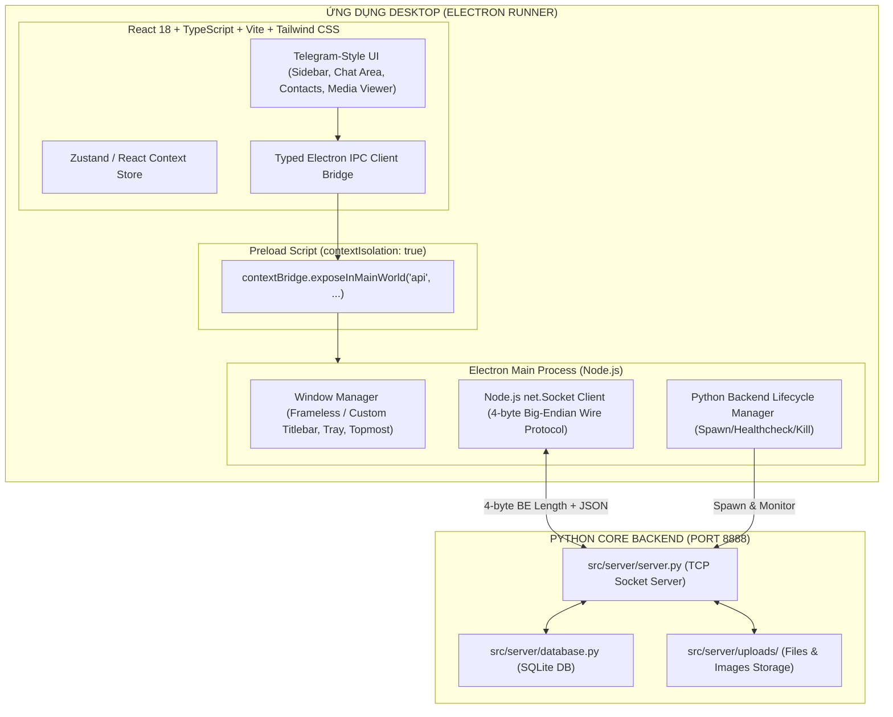

# KẾ HOẠCH CHUYỂN ĐỔI KIẾN TRÚC TỪ PYTHON GUI SANG ELECTRON + REACT + TYPESCRIPT
## DỰ ÁN: ỨNG DỤNG NHẮN TIN & TRUYỀN THÔNG TIN DESKTOP (TELEGRAM-STYLE)

---

## 1. TỔNG QUAN VÀ HIỆN TRẠNG HỆ THỐNG (CURRENT ARCHITECTURE)

### 1.1. Hiện trạng Backend & Cơ sở dữ liệu
- **Ngôn ngữ**: Python 3.13.
- **Cơ sở dữ liệu**: SQLite (`src/server/chat_database.db`), quản lý bởi `src/server/database.py`.
  - Bảng dữ liệu: `users`, `conversations`, `conversation_members`, `messages`, `files`, `reactions`, `pinned_messages`, `saved_messages`, `friend_requests`, `blocks`.
  - Mật khẩu: Băm chuẩn PBKDF2-HMAC-SHA256 (100.000 vòng lặp) với salt ngẫu nhiên 16 bytes.
- **Giao thức mạng**: TCP Socket Server (`src/server/server.py`) chạy tại `127.0.0.1:8888` (hoặc WAN IP qua `run_server_wan.py`).
  - Wire Format: Packet đóng khung chuẩn 4 bytes Big-Endian Length Prefix (`!I`) theo sau bởi chuỗi JSON mã hóa UTF-8.
  - Xử lý gói tin: Đa luồng (Multi-threading), hỗ trợ các action request-response đồng bộ và event push thời gian thực (`new_message`, `user_status_changed`, `user_typing`, `call_incoming`, `call_media_relay`, ...).
- **Thư mục lưu trữ tệp đính kèm**: `src/server/uploads/` lưu ảnh và tài liệu với UUID/hash an toàn.

### 1.2. Hiện trạng Frontend cũ (Python GUI)
- **Framework**: CustomTkinter (`ctk`), Tkinter native.
- **Entry point**: `src/client/client_app.py` -> `src/client/ui/main_window.py`.
- **Giao tiếp mạng**: `src/client/network.py` (`NetworkClient`), dùng Socket TCP với thread `_listen_loop` và cơ chế tự động kết nối lại (`reconnect_and_identify`).
- **Hạn chế của GUI cũ**:
  - Tùy biến hoạt họa (animations), bo góc mượt mà, theme transitions phức tạp bị giới hạn bởi Tkinter canvas.
  - Bong bóng tin nhắn và inline media preview khó đạt độ mượt mà cao như Telegram Desktop chuẩn.
  - Đóng gói PyInstaller thành file thực thi lớn và khởi động chậm hơn so với Electron + V8.

---

## 2. KIẾN TRÚC MỚI (TARGET ARCHITECTURE)

### 2.1. Công nghệ Frontend mới
- **Thư viện UI**: React 18, TypeScript (Strict Mode).
- **Build Tool**: Vite (cực nhanh, HMR tức thì).
- **CSS / Styling**: Tailwind CSS (Dark/Light mode native), phong cách thiết kế tối giản, sạch sẽ Telegram Desktop.
- **Icons**: Lucide React.
- **Quản lý trạng thái**: Zustand / Custom Hooks chuyên biệt theo từng module.

### 2.2. Kiến trúc Desktop Electron
- **Electron Main**:
  - `contextIsolation: true`, `nodeIntegration: false`.
  - Quản lý cửa sổ: Window State Persistence, System Tray, Minimize to Tray, Always on Top, Frameless Header kiểu Telegram.
  - Quản lý tiến trình Python con: Tự phát hiện server hiện có (port 8888), nếu chưa chạy sẽ tự spawn `python src/server/server.py` và tắt sạch sẽ khi app thoát.
  - Module `net.Socket` kết nối trực tiếp với TCP Server Python, giải mã 4-byte header và chuyển tiếp sự kiện qua `window.webContents.send`.

---

## 3. DANH SÁCH CHỨC NĂNG PHẢI BẢO TOÀN (FEATURE PARITY)

| STT | Chức năng | Cơ chế Backend | Trạng thái bảo toàn |
|---|---|---|---|
| 1 | Đăng ký & Đăng nhập | `action: "register"`, `action: "login"` | 100% |
| 2 | Danh sách hội thoại (Direct, Group, Saved) | `action: "get_conversations"`, `get_saved_conversation` | 100% |
| 3 | Nhắn tin văn bản thời gian thực | `action: "send_message"`, push `new_message` | 100% |
| 4 | Trả lời trích dẫn (Quote/Reply) | `reply_to_id`, `reply_preview` trong payload | 100% |
| 5 | Ghim tin nhắn (Pin Message) | `action: "pin_message"`, `action: "get_pinned_message"` | 100% |
| 6 | Thả cảm xúc tin nhắn (Reactions) | `action: "toggle_reaction"`, push `reaction_updated` | 100% |
| 7 | Thu hồi tin nhắn 2 phía | `action: "recall_message"`, push `message_recalled` | 100% |
| 8 | Gửi ảnh & tệp tin đính kèm | `action: "upload_file"`, `action: "download_file"` | 100% |
| 9 | Cloud của tôi (Saved Messages) | `action: "get_saved_conversation"` | 100% |
| 10 | Tìm kiếm người dùng theo username/ID | `action: "search_users"` | 100% |
| 11 | Quản lý danh bạ, kết bạn, chặn | `action: "send_friend_request"`, `"block_user"`, ... | 100% |
| 12 | Tạo nhóm chat mới | `action: "create_group"` | 100% |
| 13 | Cuộc gọi Thoại & Video (Signaling) | `action: "call_request"`, `"call_accept"`, `"call_media"` | 100% |
| 14 | Thông báo đối phương đang soạn thảo (Typing) | `action: "typing"`, push `user_typing` | 100% |
| 15 | Khóa màn hình nhanh (Quick App Lock) | Mã PIN client-side / hash xác thực | 100% |
| 16 | Ghim cửa sổ trên cùng (Always on Top) | Electron `setAlwaysOnTop` | 100% |
| 17 | Tự động kết nối lại khi mất mạng | Socket retry heartbeat & auto-identify | 100% |
| 18 | Chế độ Giao diện Tối / Sáng (Dark/Light) | Tailwind CSS `class="dark"` toggle | 100% |

---

## 4. RỦI RO TƯƠNG THÍCH & PHƯƠNG ÁN XỬ LÝ (RISKS & MITIGATIONS)

1. **Rủi ro phân mảnh gói tin TCP (TCP Packet Fragmentation)**:
   - *Nguyên nhân*: Stream TCP có thể cắt gói JSON lớn (như file base64) thành nhiều chunks.
   - *Giải pháp*: Node.js `net.Socket` trong Electron main triển khai bộ đệm `Buffer` đọc đúng 4 bytes header trước khi gom đủ `length` bytes body tương tự `_recv_exact` ở Python client.
2. **Xung đột tiến trình Server Python**:
   - *Nguyên nhân*: Server có thể đã đang chạy (như daemon trên port 8888).
   - *Giải pháp*: Trước khi spawn subprocess Python, Electron kiểm tra port 8888 bằng TCP ping. Nếu đã có server đang lắng nghe, dùng luôn server đó; nếu chưa có thì mới spawn `src/server/server.py`.
3. **Bảo tồn Python GUI cũ**:
   - Toàn bộ thư mục `src/client/ui/`, `src/client/desktop/`, `src/client/client_app.py` được **giữ nguyên 100%**. Người dùng hoặc ban chấm đề tài có thể chạy song song cả 2 bản bất kỳ lúc nào qua lệnh `python run_client.py` hoặc chạy bản Electron.

---

## 5. KẾ HOẠCH TRIỂN KHAI THEO GIAI ĐOẠN

- **Giai đoạn 1**: Khởi tạo thư mục `electron-app/` với Vite + React + TypeScript + Tailwind CSS + Lucide Icons.
- **Giai đoạn 2**: Xây dựng lớp giao tiếp an toàn Electron IPC (`electron/main.ts`, `electron/preload.ts`, `electron/python_bridge.ts`).
- **Giai đoạn 3**: Thiết kế giao diện Telegram Desktop chuẩn (Header, Sidebar danh sách chat, Chat Area, Composer, Modal xem ảnh, Danh bạ, Tạo nhóm, Settings, Lock Screen).
- **Giai đoạn 4**: Tích hợp các luồng dữ liệu thời gian thực và xác thực.
- **Giai đoạn 5**: Viết unit test & component test cho frontend (`vitest`), kiểm tra regression backend (`pytest`).
- **Giai đoạn 6**: Cấu hình đóng gói Windows Executable / Installer qua `electron-builder`.
- **Giai đoạn 7**: Cập nhật CI/CD và xuất bản báo cáo chi tiết.

