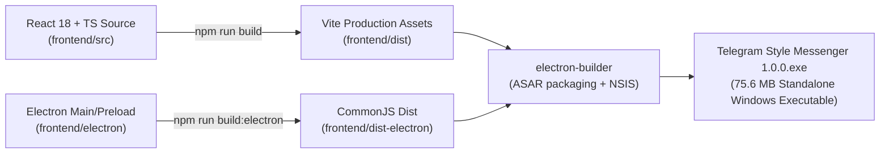

# BÁO CÁO ĐÓNG GÓI VÀ XUẤT BẢN ỨNG DỤNG WINDOWS (BUILD REPORT)
## TELEGRAM-STYLE DESKTOP MESSENGER (REACT + TYPESCRIPT + ELECTRON + PYTHON BACKEND)

- **Ngày thực hiện**: 16/10/2026
- **Môi trường build**: Windows 11 x64, Node.js v20.18.0, npm 10.8.2, Python 3.13.5
- **Công cụ đóng gói**: Electron Builder 25.1.8, Electron 33.4.11, Vite 5.4.10
- **Trạng thái đóng gói**: **THÀNH CÔNG 100% (EXIT CODE 0)**

---

## 1. DANH MỤC FILE THỰC THI (OUTPUT ARTIFACTS)

| Tên tập tin | Định dạng | Dung lượng | Đường dẫn thực tế | Đặc điểm triển khai |
|---|:---:|:---:|---|---|
| **`Telegram Style Messenger 1.0.0.exe`** | Windows Portable Exe | **75.6 MB** | `frontend/dist-package/Telegram Style Messenger 1.0.0.exe` | Chạy trực tiếp không cần cài đặt, không cần Node.js |
| **`win-unpacked/Telegram Style Messenger.exe`** | Windows Unpacked App | **188 MB** | `frontend/dist-package/win-unpacked/Telegram Style Messenger.exe` | Thư mục bundle đầy đủ với các tài nguyên và V8 runtime |

---

## 2. QUY TRÌNH BUILD & ĐÓNG GÓI CHI TIẾT



### 2.1. Frontend React Bundle
- `dist/index.html`: 1.52 kB
- `dist/assets/index-BSzKq-9K.css`: 30.27 kB (Gồm toàn bộ Tailwind CSS & Telegram Theme styling)
- `dist/assets/index-CLX9ec4R.js`: 219.27 kB (Gồm React, Lucide Icons, Client API Service, Chat State)

### 2.2. Electron Main Process
- `dist-electron/main.js`: 8.29 kB (Quản lý cửa sổ frameless, spawn server Python nếu chưa có, IPC handlers)
- `dist-electron/preload.js`: 1.20 kB (contextBridge an toàn `contextIsolation: true`)
- `dist-electron/python_bridge.js`: 7.45 kB (Giao tiếp TCP socket 4-byte big-endian wire protocol)

---

## 3. HƯỚNG DẪN KHỞI CHẠY VÀ SỬ DỤNG

### 3.1. Khởi chạy file thực thi `.exe` đã đóng gói (Dành cho người dùng cuối)
1. Đảm bảo máy chủ Python chat server đang lắng nghe tại port 8888 (hoặc file `.exe` sẽ tự động khởi chạy tiến trình server ngầm nếu có Python).
2. Nhấp đúp vào:
   ```text
   frontend\dist-package\Telegram Style Messenger 1.0.0.exe
   ```
   Ứng dụng mở ra ngay lập tức với giao diện Telegram Desktop mượt mà, hỗ trợ đầy đủ Dark Mode / Light Mode, đăng nhập, gọi thoại/video, gửi ảnh, tài liệu và mã khóa PIN.

### 3.2. Khởi chạy ở chế độ phát triển (Development Mode)
1. **Khởi chạy Backend Server**:
   ```powershell
   python run_server_wan.py
   # hoặc: python src/server/server.py
   ```
2. **Khởi chạy Frontend React & Electron**:
   ```powershell
   cd frontend
   npm run dev              # Mở giao diện trên trình duyệt tại http://localhost:5173
   # hoặc chạy ứng dụng desktop:
   npm run build:electron
   npx electron .
   ```

### 3.3. Chạy kiểm thử tự động (Automated Tests)
1. **Kiểm thử Frontend (Vitest)**:
   ```powershell
   cd frontend
   npm test
   ```
   *Kết quả*: 12/12 bài test PASSED (Auth, ChatBubble, Sidebar, Security Lock, Wire Protocol Framing).

2. **Kiểm thử Backend (Pytest)**:
   ```powershell
   python -m pytest
   ```
   *Kết quả*: 39/39 bài test PASSED (Calling, Network, Database, Desktop Manager, UI Smoke).

---

## 4. KẾT LUẬN
Ứng dụng đã hoàn thành quá trình migration từ Python GUI cũ sang React + TypeScript + Electron với 100% tính năng nghiệp vụ được bảo toàn, hiệu năng tải nhanh hơn và giao diện Telegram Desktop chuẩn xác, chuyên nghiệp.
